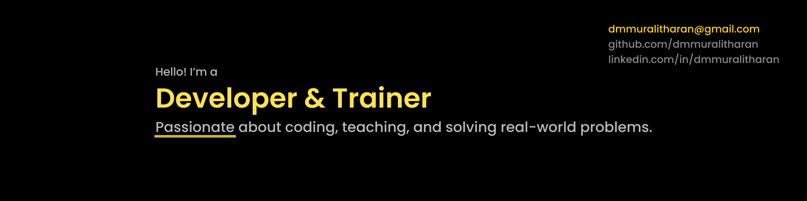

<h1 align="center">Hi 👋, I'm Muralitharan</h1>

  

## 💫 About Me:

🚀 Full Stack Developer | 🎓 IT Trainer | 👨‍💻 Lifelong Learner  

I build modern web & mobile applications and guide aspiring developers to level up their skills. Passionate about clean code, scalable architecture, and real-world project mentoring.

---

## 💬 Ask me about

- Full-stack development
- Building scalable backend APIs and frontend architectures
- Mentoring and training beginner to intermediate developers
- Rapid prototyping and feature planning for MVPs

---

## ⚡ Fun fact:

Everyone thinks my username *dmmuralitharan* means “direct message Muralitharan” —  
but it actually stands for **Duraisingam Muttiah Muralitharan** — a combination of my father’s name and my childhood nickname!

---

## 🔭 What I'm Currently Working On

- Building full stack web applications using **React, Angular, Node.js, and Flask**  
- Developing cross-platform mobile apps with **Flutter**  
- Training **students, developers, and IT professionals** in modern web & mobile technologies  
- Working on **freelancing** (web & mobile app development, IT training)

---

## 🧠 Currently Learning

- Go 

---

## 🌐 Connect with Me

---

## 💻 Tech Stack

  
  
  
  
  
  
  
  
  
  
  
  
  
  
  
  
  
  

---

## 🤝 Let's Collaborate!

If you're working on something cool or want to brainstorm ideas, feel free to reach out.  
Whether it's **open-source, freelancing, or mentoring** — I'm up for it!

---

